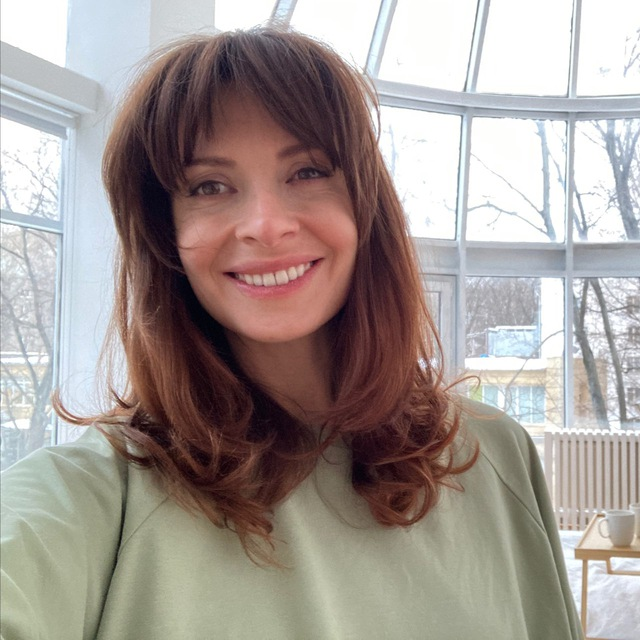
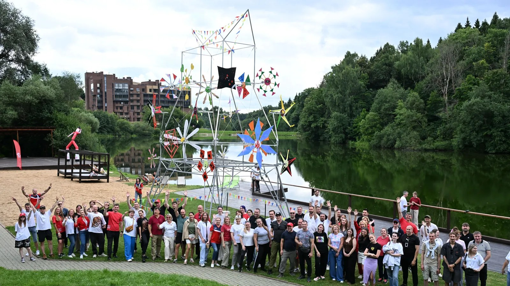

# Мария Варламова

Основатель и генеральный директор [Каталиста](https://catalystrussia.ru/?utm_source=github.com&utm_medium=profile&utm_campaign=readme). 15 лет в ивент-индустрии.

Каталист: ивент-агентство для крупных компаний. С 2010 года больше 5 000 проектов, 16 наград ивент-индустрии, 50+ программ. Тимбилдинги и корпоративы под ключ для групп от 50 до 3 000 человек. Москва, Берсеневская набережная, 6, стр. 3.

## Чем занимаемся

- Тимбилдинги для команд от 50 человек: на площадке, на природе, выездные.
- Корпоративные ивенты: конференции, юбилеи компаний, новогодние праздники.
- AI-Практикум: 7 программ про нейросети для команд.
- Маркетинг и реклама для ивентов.

## Программы

- [Фестиваль Фудтраков](https://catalystrussia.ru/teambuilding/vse-programmy/festival-fudtrakov/?utm_source=github.com&utm_medium=profile&utm_campaign=readme), премии «Событие года» и «Золотой пазл»
- [WOW Пицца](https://catalystrussia.ru/teambuilding/vse-programmy/wow-pizza/?utm_source=github.com&utm_medium=profile&utm_campaign=readme)
- [WOW Башня](https://catalystrussia.ru/teambuilding/vse-programmy/wow-bashnya/?utm_source=github.com&utm_medium=profile&utm_campaign=readme)
- [Гонки Формула 1](https://catalystrussia.ru/teambuilding/vse-programmy/formula-1/?utm_source=github.com&utm_medium=profile&utm_campaign=readme)
- [Город Мегаполис](https://catalystrussia.ru/teambuilding/vse-programmy/gorodskaya-strojka/?utm_source=github.com&utm_medium=profile&utm_campaign=readme)
- [Art&Fun&Sport](https://catalystrussia.ru/teambuilding/vse-programmy/art-fun-sport/?utm_source=github.com&utm_medium=profile&utm_campaign=readme)
- [Тимбилдинг с нейросетями](https://catalystrussia.ru/programmy/timbilding-s-neirosetyami/?utm_source=github.com&utm_medium=profile&utm_campaign=readme)
- [Стартап с нейросетями](https://catalystrussia.ru/startap_business_game/?utm_source=github.com&utm_medium=profile&utm_campaign=readme), победитель BEMA 2025
- [Корпоратив под ключ](https://catalystrussia.ru/korporativ/?utm_source=github.com&utm_medium=profile&utm_campaign=readme)

## Видео

- [Визитка Каталиста, 1 минута](https://www.youtube.com/watch?v=NRoCOBLretU)
- [Шоурил: лучшие кадры тимбилдингов, 1:42](https://www.youtube.com/watch?v=zg8kW6uYfO8)
- [Фестиваль Фудтраков: обзор от Ирека Мансурова, 1:30](https://www.youtube.com/watch?v=hS1GU-a5QvE)

## Где нас найти

- Сайт: [catalystrussia.ru](https://catalystrussia.ru/?utm_source=github.com&utm_medium=profile&utm_campaign=readme)
- YouTube: [@catalystrussia](https://www.youtube.com/@catalystrussia)
- ВКонтакте: [vk.com/catalystagency](https://vk.com/catalystagency)
- Telegram: [t.me/catalyst_agency](https://t.me/catalyst_agency)
- Max: [канал Каталиста](https://max.ru/u/f9LHodD0cOKGPNk8tLsr7rNfEOQc77ksLyB_spYPyOeeyFZdwIjxNIvtZs)
- Rutube: [канал Каталиста](https://rutube.ru/channel/77141556/)
- Дзен: [dzen.ru/catalystrussia.ru](https://dzen.ru/catalystrussia.ru)
- Телефон: +7 991 150-10-01, почта: info@catalystrussia.ru
